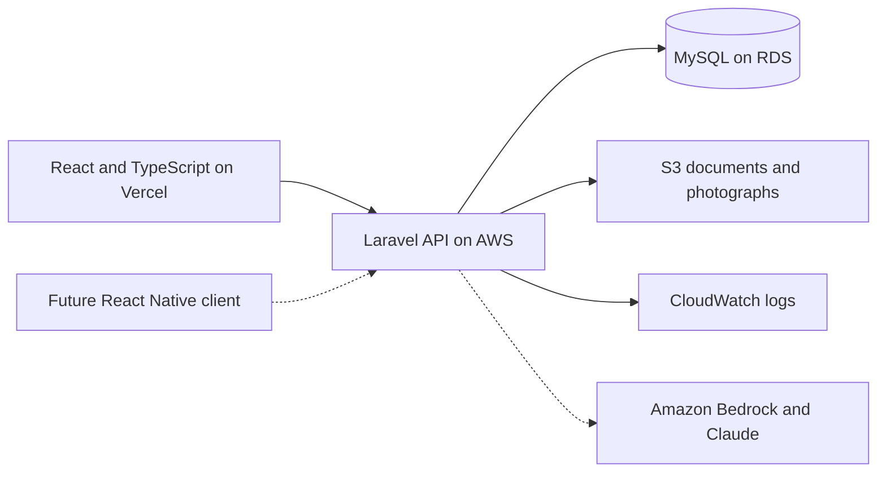

# Modern Warehouse

A goods-receiving and manifest reconciliation PoC by [Modern Software](https://modern-software.co.uk). Built to demonstrate full-stack engineering, operational product thinking and an incremental path to AI-assisted workflows.

This is an independent portfolio project using fictional customers and shipments. It is not UKP software, a reproduction of its private systems, or a customs compliance product.

## The problem

A customer supplies a manifest before goods arrive. The receiving team needs to establish whether the physical delivery matches that manifest: which parcels arrived, which are missing, and which were damaged or unexpected. Office staff need an up-to-date view without chasing the warehouse team.

**Workflow:** import expected goods → receive and verify parcel labels → record discrepancies → investigate and resolve → review the audit history.

Physical receipt and customs clearance are separate states. Receiving a parcel never clears it through customs or authorises dispatch.

## Current implementation

- React and TypeScript interface with a responsive operations dashboard.
- Five fictional shipments, searchable by reference, customer, origin or carrier.
- Parcel check-in by label entry or a keyboard barcode scanner. Duplicate and unknown scans are rejected.
- Damage, missing and unexpected-parcel reports, resolution and activity history.
- CSV manifest upload with a downloadable sample, quoted-field parsing, duplicate checks and consistent shipment metadata validation.
- Browser-local persistence and an explicit reset action for the PoC.
- A deterministic receiving brief, explicitly labelled rules-based. It does not currently invoke Claude or Bedrock.
- A Laravel 13 API with persistent shipments and parcels, validated imports, transactional receiving updates and discrepancy history; selected by `VITE_API_URL`.

The browser-local PoC is single-user. It does not provide shared persistence, production authentication, live camera scanning or server-side audit guarantees. All displayed people, companies and operational records are synthetic. Sample history is dated 10 November 2026; arrival times are part of that scenario.

## Technology and architecture

| Layer | Choice | Status |
| --- | --- | --- |
| Web UI | React, TypeScript, Vite | Implemented |
| Receiving logic | Typed state transitions and validation | Implemented in browser PoC |
| Backend | PHP and Laravel 13 | Implemented for local PoC use; feature-tested |
| Database | MySQL | Intended deployed database; SQLite for isolated backend tests |
| Frontend hosting | Vercel | Build configuration included; deployment pending |
| AWS application hosting | Container-based Laravel API, RDS MySQL, S3 attachments, CloudWatch logs | Planned; no infrastructure provisioned |
| AI | Claude through Amazon Bedrock | Design stage; no live model calls |
| Mobile | React Native using the same Laravel API | Future phase; no mobile app yet |



Solid arrows describe the intended deployed architecture, not services already provisioned. The initial Vercel PoC can operate entirely in the browser with no AWS charges.

## Run the frontend

Requires Node.js 22.12+ and pnpm.

```sh
pnpm install
pnpm dev
```

Open the local URL printed by Vite. Leave `VITE_API_URL` unset for browser-local sample data. Copy `.env.example` to `.env` only if configuration is needed. Never commit credentials.

```sh
pnpm test
pnpm build
pnpm preview
```

## Walk through the PoC

1. Open MW-1048 (Nordic Living). Eight of twelve parcels are already received.
2. Check in `MW-1048-P009`; the dashboard count and receiving history update.
3. Try the same label again. It is rejected rather than counted twice.
4. Report damage against an outstanding parcel. Reporting does not mark it received.
5. Review and resolve the report under Discrepancies; the record remains visible.
6. Inspect MW-1049: every parcel is received, but customs status remains Held.
7. Download the sample CSV and import it to create MW-1052.
8. Use Reset sample data to return this browser to the original scenario.

## Laravel API contract

The frontend expects JSON with a `data` array of shipments after each successful operation. Error responses use a `message` string. All identifiers are references rather than numeric UI row positions.

| Method | Route under `/api` | Purpose |
| --- | --- | --- |
| GET | `/shipments` | List shipments and nested receiving records |
| POST | `/shipments` | Import a validated shipment |
| POST | `/shipments/{reference}/receive` | Record a parcel receipt |
| POST | `/shipments/{reference}/exceptions` | Report a discrepancy |
| POST | `/shipments/{reference}/exceptions/{id}/resolve` | Resolve a discrepancy |

The deployed API must authenticate users, authorise shipment access, validate all writes and serialize receiving updates in database transactions. Browser validation is not an access-control boundary.

### Run the Laravel API locally

Requires PHP 8.3+ (developed on PHP 8.4), Composer and either MySQL or SQLite. Configure `backend/.env` from the example; keep it out of version control.

```sh
cd backend
composer install
cp .env.example .env
php artisan key:generate
php artisan migrate --seed
php artisan serve --host=127.0.0.1 --port=8000
```

For SQLite, create an empty `database/database.sqlite` file before migrating. For MySQL, set `DB_CONNECTION=mysql`, `DB_HOST`, `DB_PORT`, `DB_DATABASE`, `DB_USERNAME` and `DB_PASSWORD` in `backend/.env`. The migration uses MySQL-compatible schema types; MySQL execution has not yet been verified locally. Set the frontend's `VITE_API_URL=http://127.0.0.1:8000/api` and restart Vite to use the API. CORS is restricted to local frontend origins. Keep the PHP server on loopback: the API deliberately has no authentication yet and rejects production-environment requests.

```sh
php artisan test
```

The API has database-backed feature tests using isolated in-memory SQLite. Receipt and discrepancy updates lock the shipment inside a database transaction. Parcels have globally unique labels. Discrepancies and activity are currently JSON fields on a shipment; split them into indexed tables before scaling beyond this PoC. The initial implementation returns the workspace after each write; pagination is a future improvement.

## Planned Claude and agentic workflow

Start with a grounded question: **“Why is MW-1048 incomplete, and what should happen next?”**

1. Laravel receives the question and checks the user's access.
2. Claude, called through Bedrock, can request bounded read tools such as `get_shipment`, `get_receiving_history` and `get_discrepancies`.
3. Laravel validates arguments, runs approved queries and returns only relevant records.
4. Claude explains the facts and proposes an action, with references to the supporting records.
5. Any write action requires explicit approval followed by normal Laravel validation and authorisation.

No direct model-to-database access. No automatic customs clearance. Bound tool loops, request sizes and spend; log tool calls; test missing data, incorrect references, prompt injection in imported descriptions and model failures. Treat manifest text as data, not instructions. Live AWS model access and region selection are still required.

## Vercel

Import `glenadamson1984/modern-warehouse` into the `glenadamson1984s-projects` account. The frontend is at the repository root. Use the Vite preset, `pnpm build`, output directory `dist`, and Node.js 22. Leave `VITE_API_URL` empty initially. Vercel serves the frontend; it does not run the PHP backend in this configuration.

## Next milestones

1. Verify the Laravel migrations and receiving flow against MySQL.
2. Add authentication and shipment-level authorisation before connecting a public client.
3. Deploy the Laravel API on AWS and verify CORS, HTTPS, backups and monitoring.
4. Add document and photograph uploads, camera barcode scanning and accessibility improvements.
5. Implement and evaluate the Bedrock tool-calling PoC; replace the rules-based brief only when live inference is available.
6. Add a React Native floor application using the same API, including offline conflict handling.

## Learning resources

- [AWS Developers: GenAI quickstart](https://www.youtube.com/watch?v=nSv9bj5r0Mg)
- [Anthropic: Building more effective AI agents](https://www.youtube.com/watch?v=uhJJgc-0iTQ)
- [AWS Developers: Bedrock AgentCore and Strands tutorial](https://www.youtube.com/watch?v=j2wYT6jqXZY)
- [Anthropic: Building effective agents](https://www.anthropic.com/research/building-effective-agents)

Public workflow background: [UKP eCommerce services](https://www.ukpworldwide.com/ecommerce/). Product assumptions should be validated with warehouse operators rather than presented as UKP's internal requirements.
